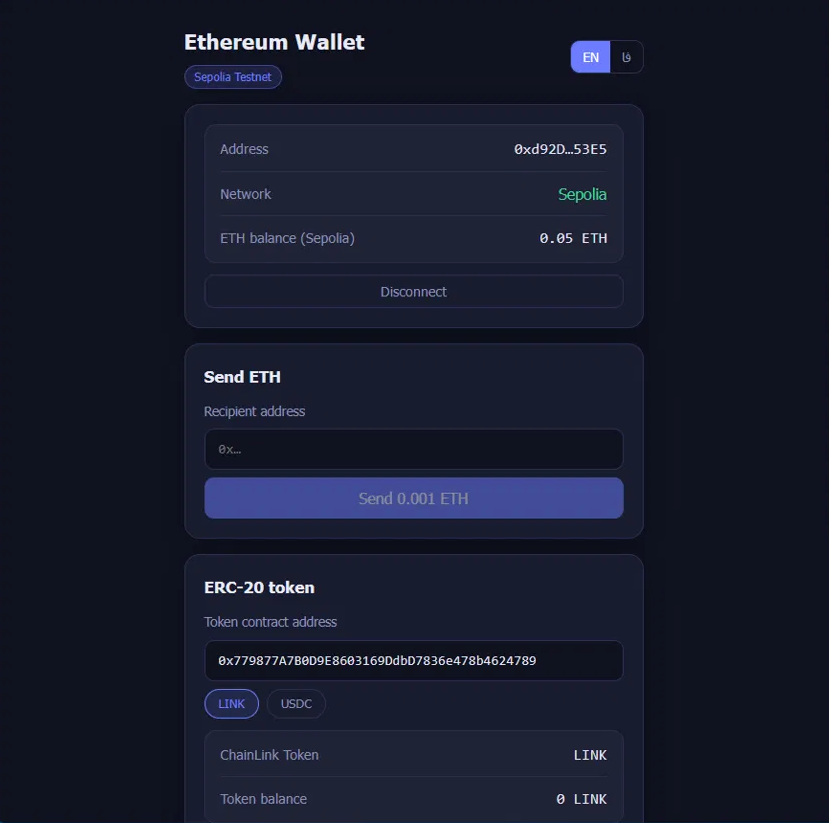
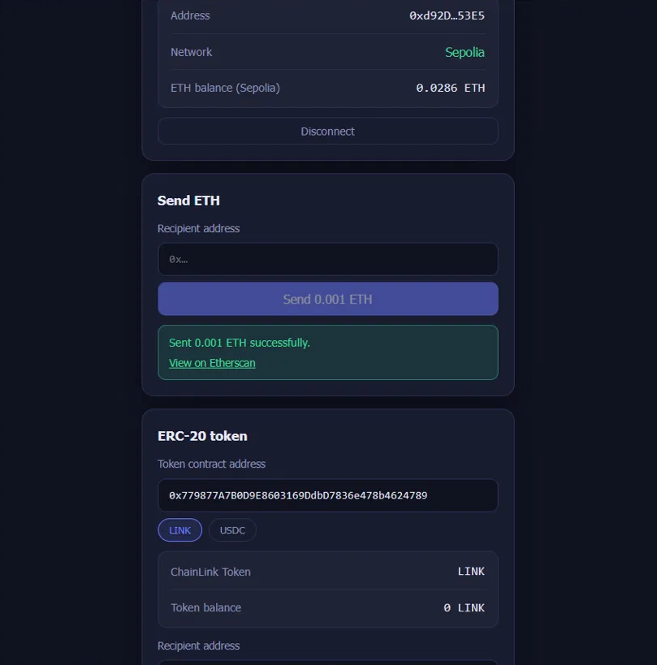

# Ethereum Wallet dApp (Sepolia)

A small, production-style dApp that connects a browser wallet, shows balances, and sends **ETH** and **ERC-20** tokens on the **Sepolia testnet** — with live `Transfer` event listening and an **English / Persian (RTL)** UI.



## Features

- **Wallet connection** via injected wallets (MetaMask, Rabby, …) with EIP-6963 discovery
- **ETH balance** and network status, with a one-click *Switch to Sepolia* (adds the network if missing)
- **Send 0.001 ETH** to any address, with validation and transaction status (signing → pending → confirmed) plus an Etherscan link
- **ERC-20 contract interaction**
  - Reads `name`, `symbol`, `decimals` and `balanceOf` in a **single multicall**
  - Sends `transfer(to, amount)` with proper decimal handling
  - **Listens to `Transfer` events** to/from your address in real time and keeps the balance in sync
  - Preset test tokens (LINK, USDC) or paste any token address
- **i18n**: English by default, Persian with automatic RTL layout; choice is remembered
- **Safety**: Sepolia is the only configured chain, and sending is disabled on any other network

## Tech stack

React 18 · TypeScript · Vite · [wagmi](https://wagmi.sh) v3 · [viem](https://viem.sh) · TanStack Query

## How it maps to wagmi / viem

| Feature                          | Hook / API                                                       |
| -------------------------------- | ---------------------------------------------------------------- |
| Connect / disconnect / chain     | `useConnection`, `useConnectors`, `useConnect`, `useDisconnect`, `useSwitchChain` |
| ETH balance                      | `useBalance`                                                     |
| Send ETH                         | `useSendTransaction` + `useWaitForTransactionReceipt`            |
| ERC-20 reads (multicall)         | `useReadContracts` with viem's `erc20Abi`                        |
| ERC-20 transfer                  | `useWriteContract` + `useWaitForTransactionReceipt`              |
| Live events                      | `useWatchContractEvent` (`Transfer`, filtered by `from` / `to`)  |
| Validation / formatting          | `isAddress`, `isAddressEqual`, `parseEther`, `parseUnits`, `formatUnits` |

## Getting started

Requirements: **Node.js 18+** (20 LTS recommended) and a browser wallet such as MetaMask.

```bash
npm install
npm run dev
```

Open the printed local URL, connect your wallet and switch to Sepolia.

### Get test funds

- **Sepolia ETH** — any Sepolia faucet (you need a little ETH for gas)
- **Test LINK** — <https://faucet.chain.link>
- **Test USDC** — <https://faucet.circle.com>

### Environment variables

| Variable              | Required | Description                                                           |
| --------------------- | -------- | --------------------------------------------------------------------- |
| `VITE_SEPOLIA_RPC_URL` | No       | Custom Sepolia RPC URL. Falls back to the public default if empty.    |

Copy `.env.example` to `.env` to use it locally. Vite bundles `VITE_*` values into the client, so never put a secret there.

### Scripts

| Command             | What it does                      |
| ------------------- | --------------------------------- |
| `npm run dev`       | Start the dev server              |
| `npm run build`     | Typecheck and build for production |
| `npm run preview`   | Preview the production build      |
| `npm run typecheck` | Run TypeScript only               |

## Project structure

```
src/
├── main.tsx              # providers: wagmi, React Query, i18n
├── App.tsx
├── wagmi.ts              # config: Sepolia only, injected connector
├── constants.ts          # chain, ETH amount, token presets
├── i18n.tsx              # EN / FA dictionaries, RTL handling
├── components/
│   ├── Header.tsx        # title + language switch
│   ├── WalletPanel.tsx   # connect, balance, network switch
│   ├── SendEthPanel.tsx  # send 0.001 ETH
│   ├── TokenPanel.tsx    # ERC-20 read / transfer / event watching
│   ├── TransferFeed.tsx  # live Transfer event list
│   └── TxStatus.tsx      # signing / pending / success / error banner
├── hooks/useWalletState.ts
└── lib/                  # formatting + error mapping
```

## Deploy to Vercel

1. Push this repo to GitHub.
2. In Vercel, **Add New → Project**, import the repo. The Vite preset is detected automatically (`vercel.json` pins it).
3. (Optional) Add `VITE_SEPOLIA_RPC_URL` under **Settings → Environment Variables**.
4. Click **Deploy**, then paste the live URL at the top of this README.

## Notes

- Testnet only — test tokens have no monetary value.
- The app never handles private keys; every transaction is signed in your wallet.
- Live events use RPC filter polling, so they work over plain HTTP RPC endpoints. A custom RPC (see above) makes them snappier and more reliable than the public default.
